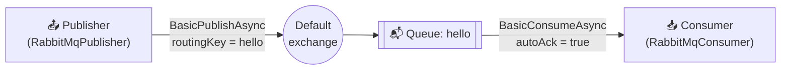

<div align="center">

# 🐇 RabbitMQ Example — .NET 8

Минимальный пример обмена сообщениями через **RabbitMQ** на **.NET 8**:
консольный **Publisher** отправляет сообщения в очередь, а **Consumer** получает их в реальном времени.


</div>

---

## 📑 Содержание

- [О проекте](#-о-проекте)
- [Архитектура](#-архитектура)
- [Структура репозитория](#-структура-репозитория)
- [Требования](#-требования)
- [Быстрый старт](#-быстрый-старт)
- [Пример работы](#-пример-работы)
- [Как это устроено](#-как-это-устроено)
- [Настройка](#-настройка)
- [Частые проблемы](#-частые-проблемы)
- [Полезные ссылки](#-полезные-ссылки)

---

## 📖 О проекте

Проект демонстрирует базовый сценарий **«Hello World»** из мира брокеров сообщений:

- **Publisher** читает текст из консоли и публикует его в очередь `hello`;
- **Consumer** подписывается на ту же очередь и выводит каждое полученное сообщение.

Код написан на **полностью асинхронном API** `RabbitMQ.Client` 7.x
(`CreateConnectionAsync`, `CreateChannelAsync`, `BasicPublishAsync`, `AsyncEventingBasicConsumer`).

---

## 🏗 Архитектура



Сообщения идут через **default exchange** (`""`): он маршрутизирует сообщение напрямую в очередь, имя которой совпадает с `routingKey`.

---

## 📂 Структура репозитория

```text
RabbitMQExampleNet8/
├── RabitMqPublisher.sln            # Solution с обоими проектами
├── RabitMqPublisher/
│   ├── Program.cs                  # Отправка сообщений из консоли
│   └── RabitMqPublisher.csproj
└── RabbitMqConsumer/
    ├── Program.cs                  # Получение и вывод сообщений
    └── RabbitMqConsumer.csproj
```

---

## ✅ Требования

| Компонент | Версия |
|-----------|--------|
| [.NET SDK](https://dotnet.microsoft.com/download/dotnet/8.0) | 8.0+ |
| [RabbitMQ](https://www.rabbitmq.com/docs/download) | 3.x / 4.x (локально или в Docker) |
| [Docker](https://www.docker.com/) *(опционально)* | любой актуальный |

---

## 🚀 Быстрый старт

### 1. Запустите RabbitMQ

Проще всего — через Docker (вместе с веб-панелью управления):

```bash
docker run -d --name rabbitmq \
  -p 5672:5672 -p 15672:15672 \
  rabbitmq:management
```

> [!TIP]
> Панель управления будет доступна по адресу <http://localhost:15672>
> (логин / пароль: `guest` / `guest`).

### 2. Клонируйте репозиторий

```bash
git clone https://github.com/aldabergenovb/RabbitMQExampleNet8.git
cd RabbitMQExampleNet8
dotnet restore
```

### 3. Запустите Consumer

В **первом** терминале:

```bash
dotnet run --project RabbitMqConsumer
```

### 4. Запустите Publisher

Во **втором** терминале:

```bash
dotnet run --project RabitMqPublisher
```

Вводите текст в окне Publisher — сообщения сразу появятся в окне Consumer. 🎉

---

## 💬 Пример работы

<table>
<tr>
<th>📤 Publisher</th>
<th>📥 Consumer</th>
</tr>
<tr>
<td>

```text
Publisher запущен. Введите текст для отправки сообщений. Для выхода введите `exit`.
Введите сообщение: Привет, RabbitMQ!
Отправлено: Привет, RabbitMQ!
Введите сообщение: Второе сообщение
Отправлено: Второе сообщение
Введите сообщение: exit
Завершение работы Publisher.
```

</td>
<td>

```text
Press [enter] to exit
Ok, received: Привет, RabbitMQ!
Ok, received: Второе сообщение
```

</td>
</tr>
</table>

> [!NOTE]
> Для выхода из обоих приложений введите `exit`.

---

## ⚙️ Как это устроено

### Publisher — [`RabitMqPublisher/Program.cs`](RabitMqPublisher/Program.cs)

1. Создаёт подключение к `localhost` и канал.
2. Объявляет очередь `hello` (`QueueDeclareAsync` идемпотентен — если очередь уже есть, ничего не произойдёт).
3. В цикле читает строку из консоли, кодирует её в UTF-8 и публикует:

```csharp
await channel.BasicPublishAsync(
    exchange: "",
    routingKey: "hello",
    mandatory: false,
    basicProperties: new BasicProperties(),
    body: Encoding.UTF8.GetBytes(message));
```

### Consumer — [`RabbitMqConsumer/Program.cs`](RabbitMqConsumer/Program.cs)

1. Подключается и объявляет ту же очередь `hello`.
2. Регистрирует асинхронный обработчик `ReceivedAsync`:

```csharp
var consumer = new AsyncEventingBasicConsumer(channel);
consumer.ReceivedAsync += (_, ea) =>
{
    var message = Encoding.UTF8.GetString(ea.Body.ToArray());
    Console.WriteLine("Ok, received: {0}", message);
    return Task.CompletedTask;
};

await channel.BasicConsumeAsync(queue: "hello", autoAck: true, consumer: consumer);
```

### Параметры очереди

| Параметр | Значение | Что означает |
|----------|----------|--------------|
| `queue` | `hello` | Имя очереди |
| `durable` | `false` | Очередь не переживёт перезапуск брокера |
| `exclusive` | `false` | Доступна для нескольких подключений |
| `autoDelete` | `false` | Не удаляется после отключения последнего консьюмера |
| `autoAck` | `true` | Сообщение подтверждается сразу при доставке |

> [!WARNING]
> `durable: false` и `autoAck: true` подходят для демонстрации, но в продакшене
> сообщения могут потеряться. Для надёжной доставки используйте durable-очереди,
> persistent-сообщения и ручное подтверждение (`BasicAckAsync`).

---

## 🔧 Настройка

По умолчанию оба приложения подключаются к `localhost:5672` с учётными данными `guest/guest`.
Чтобы подключиться к другому брокеру, измените `ConnectionFactory` в обоих `Program.cs`:

```csharp
var factory = new ConnectionFactory
{
    HostName = "my-rabbit-host",
    Port = 5672,
    UserName = "user",
    Password = "password",
    VirtualHost = "/"
};
```

---

## 🩺 Частые проблемы

<details>
<summary><b>BrokerUnreachableException: None of the specified endpoints were reachable</b></summary>

RabbitMQ не запущен или недоступен на `localhost:5672`. Проверьте контейнер:

```bash
docker ps --filter name=rabbitmq
```

</details>

<details>
<summary><b>Consumer ничего не получает</b></summary>

- Убедитесь, что оба приложения используют одну и ту же очередь `hello`.
- Посмотрите очередь в панели управления: <http://localhost:15672/#/queues>.

</details>

<details>
<summary><b>Сообщения пропали после перезапуска RabbitMQ</b></summary>

Это ожидаемо: очередь объявлена с `durable: false`. См. раздел [Параметры очереди](#параметры-очереди).

</details>

---

## 🔗 Полезные ссылки

- [RabbitMQ Tutorials — .NET](https://www.rabbitmq.com/tutorials/tutorial-one-dotnet)
- [RabbitMQ .NET Client — документация](https://www.rabbitmq.com/client-libraries/dotnet-api-guide)
- [RabbitMQ.Client на NuGet](https://www.nuget.org/packages/RabbitMQ.Client)

---

<div align="center">

Сделано с ❤️ на .NET 8 · [aldabergenovb](https://github.com/aldabergenovb)

</div>
